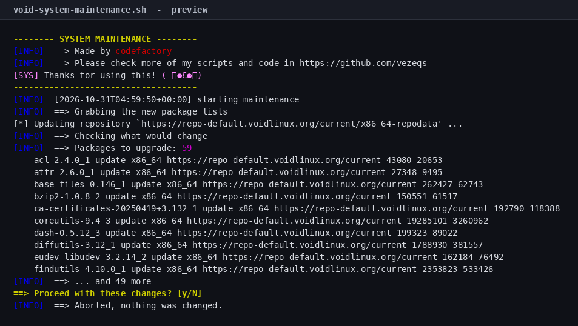
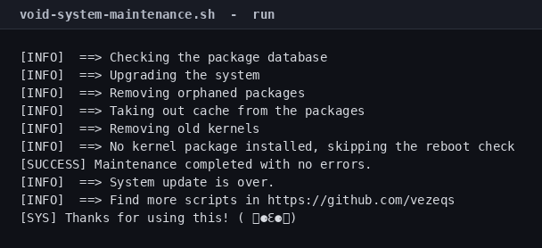

# Void System Maintenance Script

[](LICENSE)
[](#tested-on)

One command to update, clean and repair Void Linux. It shows you what will
change, **asks before touching anything**, and tells you if a reboot is needed.



## Quick start

Void does not ship bash by default, so install it once:

```bash
xbps-install -S bash
```

Then:

```bash
git clone https://github.com/vezeqs/void-system-maintenance.git
cd void-system-maintenance
sudo ./void-system-maintenance.sh
```

## What it does

| # | Step | Command |
|---|------|---------|
| 1 | Sync the package index (3 attempts) | `xbps-install -S` |
| 2 | Show what would change | `xbps-install -un`, `xbps-remove -on` |
| 3 | **Ask for confirmation** | `Proceed? [y/N]` |
| 4 | Check the package database | `xbps-pkgdb -a` |
| 5 | Upgrade everything | `xbps-install -Suy` |
| 6 | Remove orphaned packages | `xbps-remove -oy` |
| 7 | Clean the package cache | `xbps-remove -Oy` |
| 8 | Remove old kernels | `vkpurge rm all` |
| 9 | Check for a pending reboot | installed kernel packages vs `uname -r` |

## What Void does differently

- **`xbps-pkgdb -a` is the integrity check.** It checks every installed
  package's database entry, files and dependencies before the upgrade runs; the
  upgrade itself repairs version drift.
- **`vkpurge` removes old kernels** and keeps the running one, which is the
  supported way to reclaim `/boot` space on Void.
- **Orphans are a first-class concept.** `xbps-remove -o` removes packages
  installed as dependencies that nothing depends on any more.
- **Void uses runit, not systemd.** Nothing in the script depends on an init
  system, so it behaves the same on a full install, a container or a chroot.

## The confirmation prompt

Nothing is installed or removed until you answer `y`. Before asking, the script
prints how many packages would be upgraded, the first ten of them, and any
orphaned packages that would be removed:


Answer anything but `y` and it exits with `nothing was changed`.

## Options

| Flag | Effect |
|------|--------|
| `-y`, `--yes` | Skip the confirmation prompt (cron, unattended runs) |
| `-n`, `--dry-run` | Print every command without running it |
| `-h`, `--help` | Show usage |

Without `-y`, the script refuses to run if there is no terminal to confirm on,
so a cron job fails loudly instead of upgrading silently.

## Example

A real run against a `voidlinux/voidlinux` container, 59 packages behind:



## Requirements

- Void Linux (glibc or musl)
- root (`sudo`)
- Bash (`xbps-install -S bash`); the script uses bash arrays and `[[ ]]`
- `vkpurge` is optional, for old kernel removal

## Safety notes

- **`xbps-remove -Oy` deletes the package cache**, so a rollback needs a
  re-download.
- **`vkpurge rm all` deletes every kernel except the running one.** That is the
  point, but it means you cannot boot an older kernel afterwards.
- **`xbps-remove -oy` removes orphans and their dependencies.** Check the
  preview before confirming.
- **`--dry-run` never changes anything**, including the preview queries.
- **Fails fast.** `set -euo pipefail` plus an `ERR` trap that reports the failing
  command and its exit status.

## Tested on

| Image | Result |
|-------|--------|
| `voidlinux/voidlinux` | 59 packages upgraded, package database clean, no orphans, no old kernels |
| `voidlinux/voidlinux` + `linux6.12` | 59 packages upgraded; the kernel check ran and warned because the container shares the host kernel |

The container's default mirror had a certificate mismatch, so the test used
`repo-default.voidlinux.org`. That is a container image issue, not a script
issue: the script uses whatever repositories you have configured.

## Verify it yourself

```bash
make check
```

`make check` runs `bash -n`, shellcheck when installed, the smoke tests and the
asset check. The screenshots come from a real `voidlinux/voidlinux` container:

`tests/assets.sh` also verifies `assets/source.sha256`: if the script changes without regenerating the screenshots, `make check` fails.

```bash
podman run --rm -v "$PWD:/repo:ro,Z" voidlinux/voidlinux \
  sh -c 'xbps-install -S bash >/dev/null && bash /repo/void-system-maintenance.sh --dry-run'
```

## Limits

- It does not roll back and does not take snapshots.
- It does not upgrade Void from one release to the next; Void is rolling.
- It does not build from `xbps-src` or select kernels.
- `vkpurge rm all` keeps only the running kernel.
- The kernel check was exercised with `linux6.12` installed. The container
  shares the host kernel, so it correctly warned that no installed kernel
  matches the running one.

## License

MIT — see [LICENSE](LICENSE).

## Author

**codefactory** — [github.com/vezeqs](https://github.com/vezeqs)
